# Architecture & Reasoning Blueprint — Team 10 — Fanatic

- **Team Number & Name:** `Team 10 — Fanatic`
- **Team Members:** Syed Mushahid Hussain, Aaryan Adil, Ashhad Ahmad
- **Chosen Paradigm & Stack (1 line):** LLM reads and writes, code decides and checks: an LLM extractor (verbatim-quote gate, context fields, majority vote, blocker double-check) feeds a deterministic decision layer (root-cause statuses, advocacy gate, request verdicts, work-setting fit, code-set plan skeleton, backtested case ranker); the LLM only words the plan, and a deterministic verifier with an output tripwire checks it (Python 3.9 + OpenAI SDK + PyYAML; model pinned in `config.yaml`).

```mermaid
flowchart LR
    IN["Client JSON<br/>(any format: repaired by input_check.py)"] --> X["extract.py (LLM x3, parallel)<br/>facts + verbatim quotes + subject/time<br/>majority vote 2-of-3"]
    X --> DC["double-check (LLM)<br/>blocker facts re-read in context"]
    IN --> S["signals.py (code)<br/>metrics vs sector peers"]
    DC --> D["diagnose.py (code)<br/>cause statuses"]
    S --> D
    D --> G["gate.py (code)<br/>BLOCKED / NEUTRAL / READY"]
    G --> V["verdicts.py (code)<br/>one verdict per request"]
    V --> K["skeleton.py (code)<br/>which actions, which phase"]
    D --> R["rank_cases.py (code)<br/>top-3 precedents + band"]
    K --> P["plan.py (LLM)<br/>words each slot + root causes"]
    R --> P
    P --> VF["verify.py (code)<br/>tags, fit, gate, prerequisites,<br/>numbers, tripwire; 3 feedback rounds"]
    VF --> OUT["submission.json + trace/*.json|html"]
```

**What the LLM does:** read the client text into typed facts (the only reader of client input; no keyword lexicon), re-read blocker sentences, and write the wording of root causes, actions, reasons and open questions.
**What code does:** every costly decision: which causes are diagnosed, the gate state, every request verdict, which actions exist and in which phase, the top-3 cases, and every number (cost reconciliation, release criteria, case ROI).

---

## 1. Domain Representation & State Design

### 1.1 Core data models

| Object | Produced by | Shape |
| :--- | :--- | :--- |
| Fact `F#` | `extract.py` (LLM) | `{kind, status: active/absent/conflict/unconfirmed, subject: employees/candidates/managers/customers/product/finance/other, time: current/past_resolved/planned, cohort, quote (verbatim), source_field, eligible, healthy_aspect, request fields: urgency/scope/skipped_prerequisite/levers/touches_healthy_asset/relies_on_noise}` |
| Workforce `W#` | `extract.py` (LLM) | `{type: knowledge_worker/deskless_frontline/clinical, work_setting: store/route_driving/warehouse/clinic/lab/office/field, cohort, is_hiring_target, quote}` |
| Cost item `E#` | `extract.py` (LLM) + amount check | `{amount_eur, role: total/driver/other, cause_kind, quote}`; the amount must be written in the quote |
| Signal `S#` | `signals.py` | metric vs sector peer with polarity (`knowledge/metrics.yaml`); thresholds read from snippet text (R1's 1.1 star) |
| Cause decision | `diagnose.py` | `{id, label, status: diagnosed/contributing/conflict/ruled_out/absent, score, evidence ids, reason}` over `knowledge/causes.yaml` |
| Gate | `gate.py` | `{state: BLOCKED/NEUTRAL/READY, blocking, pending, ready_conditions, release_criteria}` (`knowledge/gate.yaml`) |
| Request verdict | `verdicts.py` | `{request_fact_id, verdict: BLOCKED/DEFERRED/RESEQUENCED/RESCOPED/NOT_SUPPORTED/ACCEPTED, reasons, banned_levers, rescope_to}` |
| Plan skeleton | `skeleton.py` | slots `{slot_id, ids (tags), phase, conditional, verifies, label}`, <= 5 per phase |
| Trace | `run.py` / `tracing.py` | everything above + votes, double-check readings, verifier rounds, removals, case ranking |

**Knowledge files (all YAML, no company names, linted):** `interventions.yaml` (24 interventions: fit, phases, prerequisites, triggers), `causes.yaml` (13 causes + scoring), `gate.yaml`, `verdicts.yaml`, `reading.yaml` (context filter, double-check kinds, vote settings), `skeleton.yaml` (labels, merge groups, verify-with), `fit.yaml` (work-setting fit), `tripwire.yaml`, `ranker.yaml` (backtested weights), `metrics.yaml`, `rules.yaml` (6 field notes), `case_features.yaml`.

### 1.2 Cross-pillar dynamics, prerequisites & guardrails
- **Symptom -> root cause.** Causes are created only by *direct* evidence (a cause stated in the text, a non-symptom telemetry deviation, a euro driver). Symptoms (attrition, drop-off, time-to-hire, agency share, conversion) only *support* (0.5 each, capped at 1.0).
- **Trust clearly stated text.** A quote-verified text cause is **diagnosed** unless contradicted. Telemetry that exists and disagrees makes it **contributing**; an explicit negation or a failed double-check makes it **conflict**. Telemetry-only causes need score >= 1.5. At most 5 diagnosed, ranked by quote-verified evidence plus a quantified impact (euro figure, telemetry or a number in the quote); stated causes beyond 5 become *secondary* (still counted by the gate, raised as an open question, no Phase 1 "verify" check). Contributing / conflict causes become Phase 1 checks + open questions naming both sources; ruled-out causes go to do-not-touch with their numbers ("Pay below market: compensation 4.18 vs peers 3.68 -> no remediation spend").
- **Readiness gate (FN4/R5).** BLOCKED only by a *diagnosed or conflict* blocker (Say-Do Gap, management, burnout, shift burnout) or a telemetry blocker (claims gap > 1.0 star, first-year attrition > 1.15x sector). READY needs (organic voice OR >= 80% positive mentions) AND (authentic EVP OR small claims gap) AND (healthy climate OR burnout absent); healthy facts stated in text count like telemetry. A contributing blocker never blocks alone (release criterion + Phase 1 check, keeps the gate NEUTRAL). Release criteria come from the client's own numbers ("claims gap at or below 1.0 star (now 1.3, peers 0.44)"; "attrition at or below 14.7% (1.15 x 12.8%)").
- **Prerequisites and phases are set by code.** `skeleton.py` selects interventions (from active causes, verification needs, kept request levers, the READY gate, costs, prerequisite closure) and puts each in the earliest allowed phase after its prerequisites (fixed point). Deferred levers go to Phase 3 as conditional items; a lever whose prerequisite cannot come earlier is listed as "after this plan". The planner cannot add slots or move a phase (verifier: `phase_change`, `unplanned_action`).
- **Industry & workforce guardrails.** Each intervention declares `fits` (workforce family) and `fit.yaml` work settings. Work settings describe the working pattern read from workforce traits, never the sector: `frontline_shift` (on-site non-desk work in shifts, rotas or nights, in any sector), `mobile_route` (on the road / changing sites), `office_desk` (office, hybrid, remote); `other` is logged as a warning. Predictable shift rotation only for frontline_shift cohorts (never route or desk staff), technical storytelling only for office_desk, fast-apply only for frontline_shift or mobile_route. Mixed workforces are checked per cohort on each action's `work_setting` tag; unknown workforce -> no misfit claim. **Advocacy** is an explicit flag (`advocacy: true`) only on interventions where employees publicly represent the employer (ambassadors, employee content); correcting job ads, previews or recruiting claims is not advocacy and never waits for the gate.
- **Evidence & cases.** Research R1-R10 carry a `measured_on` scope; team-level ranges applied company-wide are labelled ("R4: indicative read-across, not a forecast"). The 21 cases are profiled by the same signal engine (T0 metrics) plus case-feature vocabulary (problem tags, workforce, work setting). ROI strings and T1-T0 gains are inserted by code.

---

## 2. Client Intake Parsing, Normalization & Noise Filtering

- **Input format: fixed vs dynamic.** The CLI (`run.py --input / --extra-scenario`) and the GUI upload run the same repair step (`input_check.sanitize_client`), so they accept exactly the same files:

  | Part | Fixed or dynamic | Behaviour |
  | :--- | :--- | :--- |
  | Wrapper | engine format `{profile, ingaze_platform_signals, client_internal_context, metrics}`, an official flat scenario, or `{"blind_judge_scenario": {...}}` | Close misspellings are mapped (e.g. `internal_context`); any other top-level text is read as extra internal context (warning). Other wrappers are not unwrapped. |
  | `profile` | **fixed** keys: `scenario_code`, `company_name`, `industry`, `headcount_and_footprint`, `workforce_target`, `organizational_context` | Unknown profile keys become internal-context text. Only `scenario_code` matters for identity (missing: `UNLABELLED_CLIENT` in the CLI, a name-based code in the GUI). |
  | `ingaze_platform_signals`, `client_internal_context` | **dynamic**: any key names | Every text or list-of-text value is read by the LLM, labelled with its field path; nested objects are flattened to text (warning). |
  | `metrics` | **optional, exact names**: the official snapshot paths (`t0_current_snapshot.public_reputation.sub_ratings_5.management`, `career_portal_and_funnel.application_form_dropoff_pct`, `sector_peer_benchmarks.…`) | Matching numbers become peer comparisons; unknown names are ignored (a few name patterns like `…_retention_pct` are recognised); "18%" / "3,4" are converted, non-numbers dropped (warning); no metrics = text-only run. |

  In short: text is free-form (the LLM reads it whatever the field is called); profile keys and metric names are fixed (code reads them). A blank template is in `templates/client_template.json`; `templates/valleysys_converted.json` is a real-world messy intake converted to this format.
- **Input safety (`input_check.py`).** Maps misnamed sections, flattens wrong types, converts numeric strings ("3,4", "18%"), drops unusable metrics (text-only run). Every repair is a warning in the trace (and in the GUI after an upload); malformed input never crashes. API calls have a timeout and 3 retries; one failed client does not stop the others, and an all-failed run never overwrites `submission.json`.
- **Reading (LLM only).** The extractor returns atomic facts with verbatim quotes (unverifiable quotes are dropped), the two context fields `subject` and `time`, workforce cohorts with work setting, euro cost items, and a coverage list of every problem / strength / request sentence. **Only current facts about employees, candidates or managers can create or support a cause or a blocker** ("Customer churn fell to 3%", "Annual turnover reached EUR 40M", "A football star is our brand ambassador" create nothing; tested).
- **Normalization.** One fact kind per concept regardless of phrasing ("6-month churn", "first-year turnover" -> `early_attrition`); low numbers are strengths (a small claims gap / attrition below sector -> `healthy_item` with `healthy_aspect`), never blocker candidates.
- **Majority vote.** The extractor runs 3 times in parallel; a cause-level fact (kind + subject + polarity) is kept only if >= 2 runs agree; request levers, urgency and work settings are voted the same way. Vote counts are in the trace.
- **Double-check.** Every advocacy-blocker fact is re-read by a second, narrow LLM call on its sentence +/- 1 neighbour ("present / absent / unclear, about whom, current?", with the exact deciding phrase, which must be verbatim). Disagreement on a present problem -> `conflict` (fail closed); absent vs unclear -> `unconfirmed` (verify, never block); a disputed symptom number is never a conflict.
- **Coverage check.** Any noticed sentence not linked to a fact is raised as "noticed but not classified: <quote>" (trace + open question). Nothing is dropped silently.
- **Noise.** Rows from another business context are their own fact kind, quarantined with one trap entry each; a request built on them is BLOCKED.

---

## 3. Diagnostic, Prioritization & Action-Planning Mechanism

1. **Diagnose** (`diagnose.py`): cause statuses as in 1.2; cost reconciliation of a stated total vs its named drivers ("named drivers = EUR 1.45M plus unexplained EUR 350k of the EUR 1.8M total" + a Finance question).
2. **Gate** (`gate.py`): state + release criteria; deferral of every advocacy lever follows it.
3. **Request verdicts** (`verdicts.py`): the LLM reads each request (any job title); code gives exactly one verdict, priority BLOCKED > DEFERRED > RESEQUENCED > RESCOPED > NOT_SUPPORTED > ACCEPTED. A request that skips a prerequisite ("tomorrow", "before any audit") is RESEQUENCED whatever a READY / NEUTRAL gate says (a BLOCKED gate still defers advocacy); company-wide scope with site differences adds "rescoped to a pilot". `blocked_traps_and_guardrails` holds exactly one entry per request and per noise row; unrequested guardrails move to do-not-touch. Official results: CloudNova CEO campaign DEFERRED, VP salary bands / shift schedules BLOCKED; EuroFreight LinkedIn blog BLOCKED, fast-apply tomorrow RESEQUENCED; VerdeCare EVP overhaul BLOCKED, tracking on 50 sites tomorrow RESEQUENCED + pilot.
4. **Skeleton** (`skeleton.py`): which actions and which phase (<= 5 per phase; related diagnostics merged, e.g. "360 listening + Exit and team-risk analysis"). **Cause -> fix coverage:** every diagnosed cause needs a non-diagnostic fix by Phase 2; the only fix of a cause is protected from the cap, and a fix removed by eligibility (e.g. shift rotation for a route workforce) is reported as a `cause_fix` violation with the reason instead of being dropped. A successful internal pilot in the text must be cited in the related fix and in the CFO dashboard.
5. **Case ranking** (`rank_cases.py`): score = root cause (IDF-Jaccard of problem/strength tags, culture match capped at 0.15 of the total) + T0 similarity + work setting (+ sector), times a contamination penalty (precedent interventions that do not fit the workforce; no compatible work setting). Text-only clients (no metrics or < 8 facts) use root cause + work setting. Weights chosen by leave-one-out over the 21 cases (each case as a query, top-3 from the other 20): **0.4194** (old weights 0.378). Work settings are read from workforce traits (frontline_shift / mobile_route / office_desk, never from the sector); the earlier fine-grained settings scored 0.4258 but treated an on-site shift workforce in a new sector as unknown. The 0.4194 configuration is the best one that keeps text-only logistics clients on logistics precedents and clinical clients off desk/tech precedents; the floor was lowered from 0.425 to 0.419 accordingly. Each case shows a match band (strong >= 0.6, moderate >= 0.4, weak); "No close precedent in the library" when none reaches moderate.
6. **Planner** (`plan.py`, LLM): writes one 25-35-word line per slot (code prefixes the standard name, e.g. "Ambassador selection: ..."), the root-cause sentences for the code-diagnosed causes, the reason for each request verdict, research citations and open questions. The detailed "how" is in `action_rationales`.
7. **Verifier** (`verify.py`, code): on the action **tags** (`intervention_id` / `nearest_intervention_id` / `is_advocacy` / `cohort` / `work_setting`): workforce and work-setting fit, gate readiness, prerequisites, banned request levers, healthy-asset protection, root-cause decisions, Phase 1 verification of unconfirmed causes, slot structure and length, evidence ids, and that every number exists in the input, research, case data or code-derived numbers. **Tripwire** (`tripwire.py`): ~10 trap phrases on the output, each needing a context word in the same clause and ignored after keep / existing / unchanged / read-only / no / not / avoid / instead of; a hit that disagrees with the tags is sent back to the planner and never removes anything by itself. Up to 3 feedback rounds, then code enforcement (logged).

**Live what-if** (`python run.py --input inputs/X.json --set fact.say_do_gap=absent`): prints the deterministic diff first (gate, cause statuses, request verdicts, code-set phases, top-3 cases), then the plan diff. `--extra-scenario file.json` adds a client to the run; a matching `scenario_code` replaces that scenario.

---

## 4. Tech Stack & Production Trade-Offs

| Layer | Chosen Tool / Library | Why We Picked It Over Alternatives |
| :--- | :--- | :--- |
| **Data / State Layer** | YAML knowledge files + JSON traces | Domain experts edit rules, thresholds, labels and weights without code; every decision is in the trace; diffs cleanly in git. |
| **Reasoning / Planning Layer** | Python: diagnose / gate / verdicts / skeleton / ranker | Deterministic given the facts; CFO-auditable; one rule change = one YAML line + a test. |
| **LLM / Parsing Layer** | OpenAI SDK, strict JSON schemas, disk cache | The LLM is the only reader (no brittle lexicon) and the writer; quote gate, majority vote and double-check bound its errors; cache makes reruns free and identical. |
| **Validation / Testing** | `eval.py`, official validator, `ingaze_tests/check_tests.py`, 120+ unit tests | One command scores validator, official expectations, test pack, plan audit, unit tests and ranker backtest, with a before/after table. |

### Why our architecture works best
1. **vs a flat single-prompt LLM:** the flat prompt has to decide and write at once; ours lets the LLM do what it is good at (reading paraphrase, writing) while code makes the decisions that must never flip (gate, verdicts, phases, numbers). Concretely, the baseline engine blocked advocacy for three healthy test clients because one sentence ("the gap ... is minimal (0.2 stars)") was misread; the double-check + "low numbers are strengths" rule removed that class of error, and the gate is now 10/10 on the test clients.
2. **vs alternative paradigms:** a keyword rule engine breaks on paraphrase (we tested 11 adversarial context sentences); a free agentic planner is non-deterministic and hard to audit; a pure case retriever copies wrong-sector playbooks (the work-setting term fixed TEST_3 getting retail cases).

## 5. Evaluation (method and results)

`python eval.py` runs the engine (LLM cache on) and prints one table: the official validator on `submission.json` and on each blind file (`--extra-scenario`), the 3 official scenarios against `tests/official_expectations.yaml` (gate, request verdicts, keyword checks), the 7-client test pack (`ingaze_tests/check_tests.py`), a plan audit on all 10 clients (trap hits, prerequisite inversions, reappearing blocked levers, duplicate / padded trap entries, ungrounded numbers, action length, phase size), unit tests and the ranker backtest. Results are saved in `results/eval/<label>.json|md`.

| Metric | Baseline (start) | Final |
| :--- | :--- | :--- |
| Validator (submission + 7 blind files) | 0 errors / 0 warnings | 0 errors / 0 warnings |
| Official checks | 68/72 | **72/72** |
| Expected gates (10 clients) | n/a | **10/10** |
| Official request verdicts | 4/6 | **6/6** |
| Test pack (`check_tests.py`) | 127/141 | **139/141** |
| Padded / duplicate trap entries | 19 / 0 | 0 / 0 |
| Phases > 5 actions / actions > 35 words | 8 / 111 | 0 / 0 |
| Unit tests | 22 | 160 passed, 0 failed |
| Ranker leave-one-out | 0.4253 | 0.4194 (trait-based work settings; floor 0.419) |

| Ungrounded numbers (strict audit) | 1 | 0 |

**Test-pack FAIL review.** Every remaining FAIL was read. (1) TEST_3 "no portal rebuild": checker miss - the action keeps "the existing one-tap application flow". (2) TWEAK_C "no wrong-sector cases": Gamma Retail is ranked 3rd - a consequence of trait-based work settings (on-site shift care staff and store staff share the frontline_shift pattern; the workforce-family factor halves but does not remove the similarity). Earlier real errors found this way (TEST_3 retail precedents, TWEAK_C desk/tech precedents, a healthy EVP getting a realignment action, a euro reconciliation against an unrelated telemetry total) were fixed with regression tests.
**Stability.** 3 uncached runs per official scenario (each with the 3-run extraction vote): EuroFreight and VerdeCare were identical in all 3 runs on gate, request verdicts, top-3 cases, diagnosed root causes and phases (slot by slot). The CloudNova runs could not complete because the API credits ran out during the check; before the majority vote and code-set phases, root causes and phases varied between runs while gate, verdicts and top-3 were already stable.
**Caveats.** The test pack and official expectations are keyword checks (a FAIL means "read this"); several FAILs were checker misses on protective wording ("keep salary bands unchanged") or synonyms. Thresholds and weights are set from the dataset documentation and field notes, not fitted on real outcomes.

## 6. Known limitations
- The LLM still words the plan; wording varies between runs even when structure (gate, verdicts, causes, phases, cases) is fixed.
- The cause catalog has 13 causes; a problem outside it is kept as an open question, not a diagnosis.
- Majority vote triples extraction cost (cached afterwards); a fact the extractor misses in 2 of 3 runs is lost (logged in the trace).
- Thresholds (1.15x attrition, 80% positive mentions, scores) are hand-set; the ranker backtest uses 21 cases only.

## 7. Next steps
A variant / edge-case test set; borderline threshold bands (verify instead of flip near a threshold); causes outside the catalog; an ROI projection module; a precedent guard that explains rejected cases; the HTML trace viewer extended to the new decision objects; calibration on real client outcomes.
